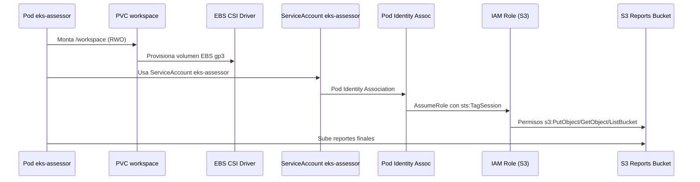

# Notas de Entrevista — EKS Migration Assessor

> Documento en español con 10 preguntas probables de entrevista técnica y respuestas concisas sobre este proyecto.

---

## 1. ¿Por qué EBS CSI Driver y no S3 para el almacenamiento de reportes?

**Respuesta:** Los dos cumplen funciones distintas y complementarias.

- **EBS CSI + PVC** → Almacenamiento de **baja latencia y alta IOPS** para el contenedor que ejecuta el escaneo. El assessor escribe reportes incrementalmente durante el análisis; EBS gp3 da latencia de milisegundos y IOPS provisionados.
- **S3** → Almacenamiento **durable, versionado y compartido** para los reportes finales. El bucket S3 persiste más allá del ciclo de vida del pod, permite acceso multi-región y políticas de ciclo de vida (Glacier/expire).

**Clave:** EBS = *working storage* del pod; S3 = *object store* de resultados persistidos.

---

## 2. ¿Pod Identity vs IRSA? ¿Por qué elegir Pod Identity?

| Aspecto | IRSA (IAM Roles for Service Accounts) | Pod Identity (EKS Pod Identity Agent) |
|---------|--------------------------------------|--------------------------------------|
| **Proveedor OIDC** | Requiere crear y gestionar proveedor OIDC en IAM | No requiere proveedor OIDC explícito |
| **Trust Policy** | Complejo: `sts:AssumeRoleWithWebIdentity` + condición `sub` | Simple: `sts:AssumeRole` + `sts:TagSession` a `pods.eks.amazonaws.com` |
| **Gestión de asociaciones** | Anotaciones en SA + política IAM | Recurso nativo `aws_eks_pod_identity_association` |
| **Etiquetado de sesiones** | No nativo | Soporta `sts:TagSession` para auditoría |
| **Madurez** | Estable, ampliamente adoptado | GA desde 2023, recomendado por AWS |

**Por qué Pod Identity aquí:** Simplifica la trust policy, elimina la gestión del proveedor OIDC, y el recurso `aws_eks_pod_identity_association` es declarativo y nativo de Terraform.

---

## 3. ¿Por qué StatefulSet con `replicas: 1` y no Deployment?

**EBS volumes son ReadWriteOnce (RWO)** — solo pueden montarse en un nodo a la vez. Un Deployment con `replicas > 1` intentaría montar el mismo PVC en múltiples pods simultáneamente → error `Multi-Attach`.

**StatefulSet con `replicas: 1`:**
- Garantiza un solo pod → un solo mount del PVC
- Identidad de red estable (`eks-assessor-0`)
- Orden de despliegue/borrado determinístico
- `volumeClaimTemplates` crea PVC automáticamente por réplica

**Para HA real:** Desplegar múltiples StatefulSets en distintas AZs, cada uno con su propio PVC/EBS en su AZ.

---

## 4. ¿Cómo maneja Terraform el estado sin backend remoto en CI?

En CI **solo validamos** — nunca aplicamos:

```bash
terraform fmt -check -recursive
terraform init -backend=false
terraform validate
```

- `-backend=false` evita inicializar backend (S3/DynamoDB)
- `validate` verifica sintaxis, referencias y tipos sin conectar a AWS
- El state file no se crea ni persiste en CI

En despliegue real (local/producción): backend S3 + DynamoDB locking.

---

## 5. ¿Cómo analizas repositorios no confiados de forma segura?

**Análisis estático puro — cero ejecución:**

1. **`git clone --depth=1 --single-branch`** — shallow clone, sin hooks, sin historial
2. **Límites:** `max_mb=100`, `timeout=60s`, `max_file_kb=512`
3. **No ejecución** — Solo `open()`, `read()`, regex, parsing YAML/Dockerfile
4. **Sandbox** — El clonado ocurre en directorio temporal aislado
5. **Limpieza** — `shutil.rmtree` al terminar (incluso en error)

**Nunca** se ejecuta `npm install`, `pip install`, `make`, tests, ni código del repo analizado.

---

## 5b. ¿Qué pasa si el repo tiene submódulos maliciosos?

`--depth=1 --single-branch` **no clona submódulos** por defecto. Git no los resuelve a menos que se pase `--recurse-submodules` (no lo hacemos).

---

## 6. ¿Por qué no Fargate?

**Fargate no soporta volúmenes EBS (PVC persistentes).**

El assessor necesita:
- PVC con EBS para almacenamiento de trabajo durante el escaneo
- Persistencia de reportes sobreviviente a reinicios de pod

Fargate solo soporta volúmenes efímeros (emptyDir) y EFS. EFS añade latencia y costo para un workload que solo necesita almacenamiento local rápido.

---

## 7. ¿Cómo maneja el scoring los falsos positivos repetidos?

**Penalidad por severidad (base):**
- CRITICAL = 25
- HIGH = 12
- MEDIUM = 5
- LOW = 2
- INFO = 0

**Cap por rule_id:** Máximo 2x la penalidad base por regla (independientemente de cuántas ocurrencias).

Ejemplo: 5 ocurrencias de `CFG-001` (CRITICAL, 25 pts) → penalidad = 2 × 25 = 50 (no 125).

Score final = `max(0, min(100, 100 - total_penalty))`.

---

## 8. ¿Cómo evita el scanner falsos positivos en código de test/comentado?

**Heurísticas actuales (limitadas):**
- Ignora directorios: `.git`, `node_modules`, `venv`, `__pycache__`, `tests/`, `test/`, `*_test.py`, `test_*.py`
- Ignora archivos binarios y >512KB
- No parsea comentarios (regex simple)

**Limitación conocida:** Puede flaggear código comentado o en tests. Mitigación futura: parseo AST por lenguaje, detección de bloques de comentario, exclusión por patrones de ruta configurables.

---

## 9. ¿Cómo se conectan las piezas en EKS? (flujo completo)



**Claves:**
1. Pod Identity elimina necesidad de OIDC provider
2. EBS CSI usa role separado (`AmazonEBSCSIDriverPolicy`)
3. App role = least privilege (solo bucket de reportes)
4. Bucket policy deniega acceso a roles ajenos al cluster

---

## 10. ¿Cómo probarías que los reportes persisten tras reinicio del pod?

**En kind (local):**

```bash
# 1. Desplegar
kubectl apply -k k8s/overlays/local

# 2. Ejecutar análisis via UI o CLI → genera reportes en /workspace

# 3. Verificar PVC
kubectl -n eks-assessor get pvc
# workspace-eks-assessor-0   Bound    pvc-xxx   5Gi   RWO   standard

# 4. Borrar pod forzadamente
kubectl -n eks-assessor delete pod eks-assessor-0 --grace-period=0 --force

# 5. Verificar recreación y persistencia
kubectl -n eks-assessor get pods -w
# eks-assessor-0   1/1   Running   ...

# 6. Verificar datos en /workspace
kubectl -n eks-assessor exec eks-assessor-0 -- ls -la /workspace/
# Deben aparecer los .md/.json generados antes del borrado
```

**En EKS:** Mismo flujo. Adicionalmente verificar que el EBS volume no se eliminó (`aws ec2 describe-volumes --filters Name=tag:kubernetes.io/created-for/pvc/name,Values=workspace-eks-assessor-0`).

---

## Preguntas adicionales probables

### "¿Cómo escalarías esto a múltiples equipos?"

- **Multi-tenancy:** Un namespace por equipo, cada uno con su ServiceAccount + Pod Identity Association + bucket S3 prefijado (`reports/team-a/`, `reports/team-b/`)
- **RBAC:** ClusterRole/RoleBinding por namespace
- **Cost allocation:** Tags por equipo en todos los recursos Terraform

### "¿Cómo integrar esto en un pipeline CI/CD real?"

1. **Job de análisis:** `eks-migration-assessor scan $REPO_URL --no-llm --out ./report`
2. **Artifact:** Subir `report-*.md` y `report-*.json` como artifacts
3. **Gate:** Fallar pipeline si `score < 65` (threshold configurable)
4. **Notificación:** Publicar resumen en Slack/PR comment via `report-*.md`

### "¿Qué métricas expondrías para observabilidad?"

- `assessor_scan_duration_seconds` (histogram)
- `assessor_score` (gauge)
- `assessor_findings_total{severity="critical|high|medium|low|info"}` (counter)
- `assessor_pvc_usage_bytes` (gauge, via kube-state-metrics)
- `assessor_scan_errors_total` (counter)

---

## Referencias rápidas

| Comando | Descripción |
|---------|-------------|
| `eks-migration-assessor scan <url> --no-llm` | CLI scan sin LLM |
| `docker compose up` | UI local en puerto 8501 |
| `kind create cluster --config k8s/kind-config.yaml` | Cluster local |
| `kubectl apply -k k8s/overlays/local` | Deploy en kind |
| `kubectl kustomize k8s/overlays/eks` | Render EKS manifests |
| `terraform -chdir=terraform validate` | Validar Terraform |
| `kubectl -n eks-assessor port-forward svc/eks-assessor 8501:80` | Acceso UI |